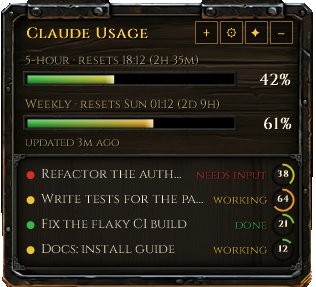
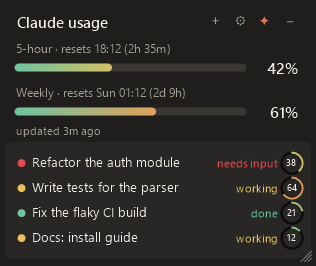

# Claude Warcraft Widget

A small Windows desktop widget for [Claude Code](https://code.claude.com): your plan's usage limits (5-hour and weekly) with a forecast of when you'll run out, and your background Claude Code chats with their status and context use, one click away. It comes in a Warcraft III look, with orc voices and game sounds, or as a plain dark card.

[](https://cdn.jsdelivr.net/gh/FXology/claude-warcraft-widget@main/docs/preview.mp4)

*Click it for [the video with sound](https://cdn.jsdelivr.net/gh/FXology/claude-warcraft-widget@main/docs/preview.mp4). The chats and numbers in it are made up. Its game sounds are © Blizzard Entertainment, used under the [Blizzard Video Policy](https://www.blizzard.com/en-us/legal/dd76b654-f2c4-4aaa-ba49-ca3122de2376/blizzard-video-policy).*

| Warcraft III look | Plain look |
| --- | --- |
|  |  |

Unofficial fan project. Not affiliated with or endorsed by Anthropic or Blizzard Entertainment. Warcraft and Blizzard Entertainment are trademarks of Blizzard Entertainment, Inc.; Claude is a trademark of Anthropic, PBC. They're named here only to say what the widget works with and looks like.

## Install

1. Download `ClaudeUsageWidget-Setup.exe` from [Releases](../../releases) and run it. It isn't code-signed, so Windows may say "Windows protected your PC": click **More info → Run anyway**.
2. It asks, then installs into `%LOCALAPPDATA%\Programs\ClaudeUsageWidget`, points Claude Code's status line at the widget (your `~/.claude/settings.json` is backed up first), starts it with Windows and launches it.
3. Your numbers appear after Claude Code's next reply.

Needs Windows 10 or 11 and Claude Code on a Pro or Max plan (only those plans report usage limits). Nothing else: the setup carries its own .NET runtime, and the status line runs inside the widget's exe, so no Node.js either. Running a newer setup over an installed copy updates it in place.

**Portable, no install:** download `ClaudeUsageWidget-Portable.zip` instead, unzip it anywhere and run `ClaudeUsageWidget.exe` (keep the `art` and `sounds` folders beside it). It changes nothing on your PC, so point Claude Code's status line at it yourself in `~/.claude/settings.json`:

```json
"statusLine": { "type": "command", "command": "\"C:/path/to/ClaudeUsageWidget.exe\" --statusline" }
```

## What it does

- **Usage limits**: 5-hour and weekly, with reset times and a countdown. When your pace this window would hit the limit before it resets, the line turns orange: `full ~16:40 · resets 18:00`. Notifications at 80% and 95%, and when a limit resets (with confetti).
- **Chats panel**: your background Claude Code chats (`claude --bg`, agent view), marked **needs input**, **working** or **done**, each with a ring showing its context use. Hover for what it's doing now; click to open it in PowerShell; middle-click for its folder; right-click to stop or remove it. `+` starts a new background chat.
- **Two looks** (menu → Display → Warcraft III look): the Warcraft one is drawn from [warcraftcn/ui](https://github.com/TheOrcDev/warcraftcn-ui) art, with loading-bar limits and the Cinzel font, plus, if you choose to download them, the orc gauntlet cursor and game sounds (see [Sounds and cursor](#sounds-and-cursor)). Click the card too many times and, like a Warcraft III critter, it bursts. The plain one is a dark card with rounded corners.
- **Small things**: drag to move, drag the corner grip to resize the whole card (text included), drag its right edge to make it wider for long chat names (menu → Display → Reset size undoes both), scroll to change opacity, Esc or `–` hides it to the tray (its icon is a column filling with your 5-hour usage), middle-click the bars for compact mode, always on top, click-through, lock position, start with Windows.

## Sounds and cursor

The Warcraft look can play game sounds on chat and widget events and use the orc gauntlet cursor. Those are © Blizzard Entertainment, so **none of them is in this repo or in the setup, and the widget never fetches them by itself**:

- **Orc lines and cursor (opt-in)**: on first start in the Warcraft look, a popup says what they are, that they're Blizzard's and not official Blizzard downloads, and where they come from: the [peon-ping](https://github.com/PeonPing/peon-ping) project's pack for the Warcraft III peon and grunt lines, and [warcraftcn/ui](https://github.com/TheOrcDev/warcraftcn-ui) for the cursor. Only if you say yes does it download them (about 1 MB), keeping each file only if it matches the SHA-256 hash pinned in `Program.cs`. You take responsibility for your use of them. You can do it later from menu → Alerts → Get Warcraft sounds & cursor. That download is the widget's only network access.
- **WoW interface sounds** are yours to add: until you do, an orc line plays in their place if you downloaded those, and the plain clicks stay quiet. To add them, save each as a WAV with the name below in the `sounds` folder next to the exe. They're Blizzard's, so add them only for your own use and never redistribute them. The links are to Wowhead, where you can listen to each.

| File | Plays when | Sound |
| --- | --- | --- |
| `QuestComplete.wav` | the weekly limit resets | [QUESTCOMPLETED](https://www.wowhead.com/sound=619) |
| `LevelUp.wav` | the 5-hour limit resets | [Level Up](https://www.wowhead.com/sound=1440) |
| `TellMessage.wav` | a chat needs your input | [TellMessage](https://www.wowhead.com/sound=3081) |
| `QuestLogOpen.wav` | you open a chat | [igQuestLogOpen](https://www.wowhead.com/sound=844) |
| `QuestFailed.wav` | a chat fails | [igQuestFailed](https://www.wowhead.com/sound=847) |
| `RaidWarning.wav` | a limit passes 95% | [RaidWarning](https://www.wowhead.com/sound=8959) |
| `BackpackOpen.wav` | you open a chat's folder | [igBackPackOpen](https://www.wowhead.com/sound=862) |
| `MenuOpen.wav` / `MenuClose.wav` | the menu opens / closes | [igMainMenuOpen](https://www.wowhead.com/sound=850) / [igMainMenuClose](https://www.wowhead.com/sound=851) |
| `CardShow.wav` / `CardHide.wav` | the card comes back / hides to the tray | [igCharacterInfoOpen](https://www.wowhead.com/sound=839) / [igCharacterInfoClose](https://www.wowhead.com/sound=840) |
| `OptionTick.wav` | you tick an option | [igMainMenuOptionCheckBoxOn](https://www.wowhead.com/sound=856) |

Turn all of it off under menu → Alerts → Game sounds. The burst's splat (`sounds/explode.wav`) and the confetti pop (`confetti.mp3`) are this project's own.

## How it works

Claude Code hands `rate_limits` and each chat's context use to its [status line command](https://code.claude.com/docs/en/statusline) after every reply. The installed widget is that command (`ClaudeUsageWidget.exe --statusline`): it saves the numbers to `%LOCALAPPDATA%\ClaudeUsageWidget\` and prints a short line such as `Opus 5.5 · ctx 8% · 5h 24% · 7d 41%`. The widget reads those files. The chat list comes from `claude agents --json --all`. No tokens or credentials are involved, and nothing about you is sent anywhere.

## Build from source

Needs the [.NET 10 SDK](https://dotnet.microsoft.com/download).

```sh
dotnet publish -c Release -o dist      # the widget, with art\ and sounds\ beside it
dist/ClaudeUsageWidget.exe --selftest  # its checks
```

To feed it from Claude Code without the installer, point the status line at it in `~/.claude/settings.json` (or at `statusline.js`, the same job in Node):

```json
"statusLine": { "type": "command", "command": "\"C:/path/to/dist/ClaudeUsageWidget.exe\" --statusline" }
```

The one-file setup (about 50 MB, with the .NET runtime inside):

```sh
dotnet publish -c Release -r win-x64 --self-contained true -p:PublishSingleFile=true -p:EnableCompressionInSingleFile=true -p:IncludeNativeLibrariesForSelfExtract=true -p:DebugType=none -o setup
```

Rename `setup/ClaudeUsageWidget.exe` to `ClaudeUsageWidget-Setup.exe`: run with no `art` folder beside it, the exe acts as the installer. Publishing to `dist` works while the widget runs from there; it restarts itself into the new build.

## Credits

- Frames and button: [warcraftcn/ui](https://github.com/TheOrcDev/warcraftcn-ui) (MIT, `art/warcraftcn-LICENSE.txt`)
- Font: [Cinzel](https://github.com/NDISCOVER/Cinzel) (SIL Open Font License, `art/Cinzel-OFL.txt`)
- Opt-in downloads, not part of this project: the orc lines (Warcraft III © Blizzard Entertainment, via [peon-ping](https://github.com/PeonPing/peon-ping)) and the orc cursor (Warcraft III © Blizzard Entertainment, via [warcraftcn/ui](https://github.com/TheOrcDev/warcraftcn-ui)). WoW sounds © Blizzard Entertainment.
- Made for this project: the loading bar and the app icon (drawn in code), the confetti pop and the burst's splat (generated with ffmpeg).

## License

[MIT](LICENSE) for this project's code and its own sounds; the third-party parts above keep their licenses.
